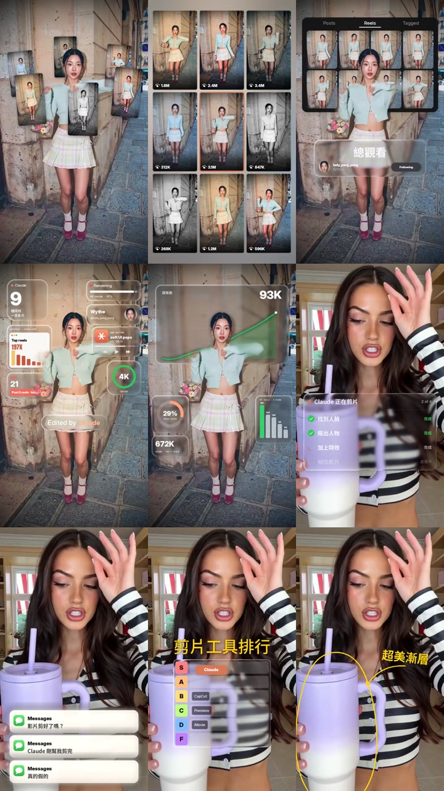

# Claude 影片特效・繁體中文版

把影片拖進 Claude，說一句話，就能加上 CapCut 要做很久的特效：圖卡繞著人轉、會動的玻璃儀表板、跟著物品移動的手繪圈⋯⋯



- 原版：[claude-video-effects](https://github.com/Vibha-Ramprakash/claude-video-effects)，作者 [@vibha.in.progress](https://instagram.com/vibha.in.progress)，51 種特效，MIT 授權
- 繁中版：@lady_yang_yung（Threads）加上繁體中文字型，以及幾個新特效與調整選項

## 需要什麼

- **Claude Code**（Claude 桌面版的 Code 分頁，或終端機版）
- 一支直式影片，人物在畫面中

第一次使用時，Claude 會自動安裝需要的工具（約 2～3 分鐘）。

## 安裝（一句話）

打開 Claude Code，貼上：

```
幫我把 github.com/wythechen0403/claude-video-effects-zh 安裝成 skill，放在 ~/.claude/skills/effects-zh
```

裝好後重開 Claude Code。

## 使用

1. 把影片拖進 Claude Code 的對話框
2. 打 `/effects-zh` 加上特效名稱，用中文描述你要的內容
3. Claude 會先截幾張畫面檢查，沒問題才輸出成品，存在原影片旁邊

時間可以用秒數，也可以直接說「講到『通過率』的時候」，Claude 會自己找出是第幾秒。

## 九宮格裡的 9 種，照抄就能用

| # | 特效 | 複製這句 |
|---|---|---|
| 1 | 繞頭圖卡 | `/effects-zh orbit 從 0 到 5 秒` |
| 2 | 縮進九宮格 | `/effects-zh place-in-grid 從 0 到 5 秒` |
| 3 | 作品牆計數 | `/effects-zh profile-wall 從 0 到 5 秒，前方玻璃卡放在畫面中間偏下，標籤寫「總觀看」，帳號換成我的 @＿＿＿` |
| 4 | 玻璃小工具 | `/effects-zh glass-widgets 從 0 到 5 秒，大數字 9，名片換成我的名字＿＿＿和帳號 @＿＿＿，Edited by Claude 移到大腿的高度` |
| 5 | 玻璃儀表板 | `/effects-zh liquid-glass-graph look=bento 從 0 到 5 秒，標題「觀看數」，數字從 0 跳到 97K` |
| 6 | 任務清單 | `/effects-zh checklist 從 0 到 5 秒，標題「Claude 正在剪片」，項目：找到人臉、摳出人物、加上特效、輸出影片` |
| 7 | 訊息通知 | `/effects-zh messages 從 0 到 5 秒，三則訊息：影片剪好了嗎？／Claude 剛幫我剪完／真的假的，通知放低一點不要擋到臉` |
| 8 | 玻璃排行榜 | `/effects-zh tier-glass 從 0 到 5 秒，標題「剪片工具排行」，Claude 飛進 S 級，B、C、D 放 CapCut、Premiere、iMovie` |
| 9 | 物品塗鴉 | `/effects-zh scribble-track 從 0 到 5 秒，把我手上的杯子圈起來，圈圈跟著杯子移動，箭頭旁寫「超美漸層」` |

其他 40 多種特效的名稱和說明，請看 `SKILL.md` 裡的表格，或直接問 Claude「有哪些特效可以用？」。

## 第二彈：5 種新特效

| 特效 | 複製這句 |
|---|---|
| 透明玻璃文字 | `/effects-zh glass-text 從 0 到 5 秒，背後的玻璃字寫「CLAUDE」` |
| 發光折線圖 | `/effects-zh glow-chart 講到「＿＿」舉手的時候，數字跳到「+320%」，下面寫「觀看成長」` |
| 對話框降下 | `/effects-zh chat-drop 從 3 秒開始，我問「幫我把這支影片加上特效」，Claude 回「好的，九種特效都加好了」` |
| 真實手機畫面 | `/effects-zh phone-mock 我舉起手機的時候，手機放在左邊，請求是「剪掉前 3 秒加字幕」，步驟：「找到開頭空白」「剪掉前 3 秒」「加上中文字幕」` |
| 剪紙拼貼 | `/effects-zh paper-collage 從 0 到 4 秒，紙片字母拼出「剪紙特效」` |

拍攝建議：素面牆、鏡頭固定、頭頂留約 1/5 畫面、人物兩側留空。`phone-mock` 用的手機圖在 `assets/phone_mockup.png`，想換款式就產一張螢幕是純綠色（#00FF00）的手機圖取代它。

`phone-pop`（從手機跳出來）和 `phone-orbit`（手機上旋轉的圖卡）還在實驗中。`phone-orbit`：人物要站在畫面一側、另一側留大空間，效果才好。

## 拍攝小提醒

- **鏡頭固定**最好，手持也能用，但特效容易跟著晃
- **頭頂留一點空間**：有些特效會放在頭的上方或後方
- **全身入鏡**適合圖卡繞人、背景類特效；**半身入鏡**適合清單、通知、圖表類特效
- 特效沒有音效和字幕，請在 CapCut 另外加

## 這個版本多了什麼

| 檔案 | 內容 |
|---|---|
| `scripts/fx_zh.py` | 中文字自動換成思源黑體，粗細會配合原本的英文字型 |
| `scripts/fx_wythe.py` | 新特效 `tier-glass`、`scribble-track`、`glass-text`、`glow-chart`、`chat-drop`、`phone-mock`、`paper-collage`，以及實驗中的 `phone-pop`、`phone-orbit`，以及 `profile-wall`、`glass-widgets` 的位置選項 |
| `assets/phone_mockup.png` | `phone-mock` 用的手機圖（綠幕螢幕） |
| `scripts/track_object.py` | 物品追蹤，讓塗鴉圈跟著物品移動 |
| `fonts/NotoSansTC-VF.ttf` | 思源黑體繁中版（SIL OFL 授權，可商用） |

原版的 `scripts/fx.py` 完全沒有修改。

## 授權

- 原版程式：MIT，© 2026 Vibha Ramprakash，見 `LICENSE`
- 繁中版新增的程式：MIT，© 2026 @lady_yang_yung
- 字型與模型：各自授權檔在 `fonts/` 和 `models/`
